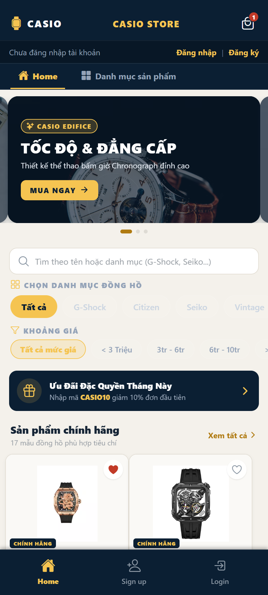
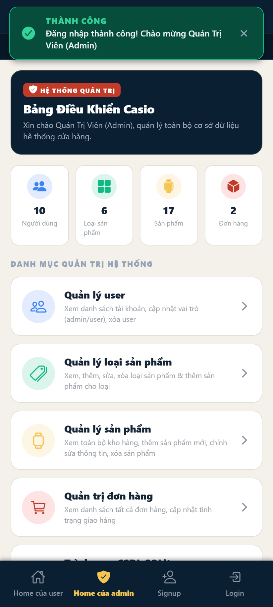
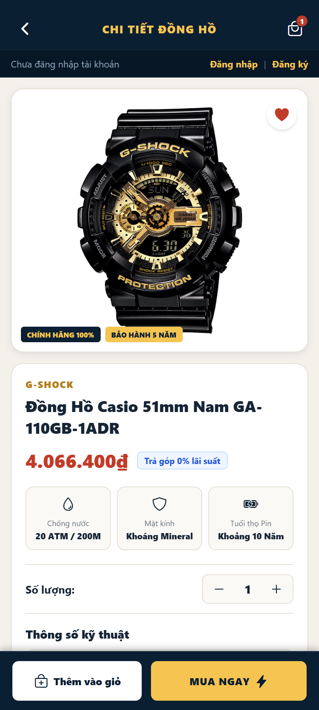
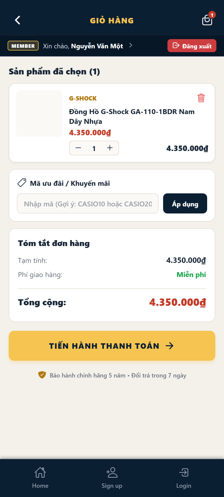
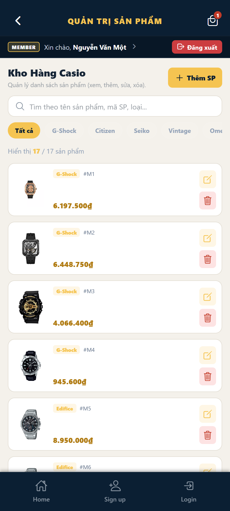
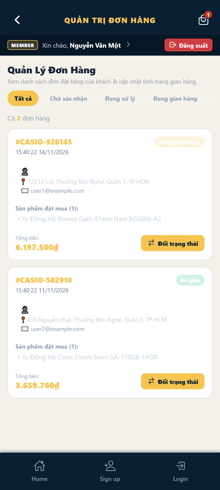

# ⌚ CASIO WATCH STORE - REACT NATIVE MOBILE APP

> Ứng dụng di động thương mại điện tử chuyên nghiệp dành cho hệ thống phân phối đồng hồ Casio chính hãng, phát triển bằng **React Native (Expo SDK 58)**, cơ sở dữ liệu **SQLite** cục bộ tốc độ cao và hệ thống điều hướng chuẩn tệp tin **Expo Router**.

[](https://expo.dev)
[](https://reactnative.dev)
[](https://www.typescriptlang.org)
[](https://docs.expo.dev/versions/latest/sdk/sqlite/)
[](LICENSE)

---

## 📱 TỔNG QUAN DỰ ÁN

**Casio Watch Store** là ứng dụng di động hoàn chỉnh phục vụ nhu cầu mua sắm đồng hồ và quản trị cửa hàng:

- **Dành cho Khách hàng:** Khám phá danh mục đồng hồ phong phú (G-Shock, Citizen, Seiko, Edifice, Vintage, Omega), bộ lọc phân tầng thông minh, xem chi tiết thông số kỹ thuật chống nước 20ATM, mặt kính khoáng/sapphire, giỏ hàng tương tác, đặt hàng giao hỏa tốc 2H, quản lý hồ sơ và lịch sử đơn hàng.
- **Dành cho Quản trị viên (Admin):** Bảng điều khiển quản trị tổng quan (Dashboard), quản lý phân quyền thành viên (Admin/User), quản trị danh mục sản phẩm, quản lý kho hàng sản phẩm toàn diện (CRUD) và xử lý luân chuyển tình trạng đơn hàng.

📖 **Tài liệu Demo chi tiết:** [Xem chi tiết toàn bộ 22 màn hình chức năng tại docs/DEMO.md](./docs/DEMO.md)

---

## 🔑 TÀI KHOẢN TRẢI NGHIỆM DEMO

| Vai trò | Tên đăng nhập (Username) | Mật khẩu (Password) | Giao diện điều hướng |
| :--- | :--- | :--- | :--- |
| **Quản trị viên (Admin)** | `admin` *(hoặc `admin@example.com`)* | `admin123` | Vào thẳng **Trang chủ quản trị** (`/admin`), Bottom Tab 4 nút, toàn quyền quản trị hệ thống. |
| **Khách hàng (User)** | `user1` *(hoặc `user1@example.com`)* | `user123` | Vào **Trang chủ mua sắm** (`/`), Bottom Tab 3 nút, sẵn có lịch sử đơn hàng và điểm tích lũy VIP GOLD. |
| **Đăng ký tài khoản mới** | Tạo bất kỳ qua tab **Sign up** | >= 6 ký tự | Tự động kiểm tra tính hợp lệ dữ liệu và lưu vào bảng `users` trong SQLite. |

---

## 📸 HÌNH ẢNH DEMO NỔI BẬT

| Trang Chủ Người Dùng | Bảng Điều Khiển Quản Trị |
| :---: | :---: |
|  |  |

| Chi Tiết Sản Phẩm | Giỏ Hàng & Thanh Toán |
| :---: | :---: |
|  |  |

| Quản Trị Kho Sản Phẩm | Quản Lý Đơn Hàng |
| :---: | :---: |
|  |  |

> 💡 *Xem đầy đủ 22 ảnh chụp màn hình và mô tả kỹ thuật tại [docs/DEMO.md](./docs/DEMO.md).*

---

## 🛠️ CÔNG NGHỆ & KIẾN TRÚC ỨNG DỤNG

- **Ngôn ngữ:** TypeScript 100%
- **Giao diện di động:** React Native `0.88.1`, React `19.3.0`
- **Điều hướng (Navigation):** `expo-router ~58.0.30` (File-based Routing theo cấu trúc thư mục `src/app/`)
- **Cơ sở dữ liệu:** `expo-sqlite ~58.0.15` (Lưu trữ cục bộ với 4 bảng: `products`, `categories`, `users`, `orders`)
- **Biểu tượng (Icons):** `@expo/vector-icons` (Bộ icon chuẩn Ionicons)
- **Hoạt họa & Cử chỉ:** `react-native-reanimated 4.7.1`, `react-native-gesture-handler ~3.3.0`
- **Tối ưu hiển thị:** `react-native-safe-area-context ~5.11.1`, `react-native-screens ~4.30.0`
- **Nền tảng hỗ trợ:** Android, iOS (qua Expo Go / Development Build) và Web Browser

---

## 🚀 HƯỚNG DẪN CÀI ĐẶT & CHẠY ỨNG DỤNG

### 1. Yêu cầu môi trường
- Đã cài đặt **Node.js** (khuyến nghị phiên bản LTS 18.x, 20.x hoặc mới hơn).
- Đã cài đặt ứng dụng **Expo Go** trên thiết bị di động (Android trên CH Play hoặc iOS trên App Store) nếu muốn chạy trên điện thoại thật.

### 2. Cài đặt các gói phụ thuộc
```bash
# Clone mã nguồn
git clone https://github.com/manhnguyen270724-sudo/mobile-casioshop.git
cd mobile-casioshop

# Cài đặt dependencies
npm install
```

### 3. Khởi chạy ứng dụng
```bash
# Chạy máy chủ phát triển Expo
npx expo start
```

- **Chạy trên điện thoại thật:** Mở ứng dụng **Expo Go**, quét mã QR hiển thị trên màn hình terminal.
- **Chạy trên trình duyệt Web:** Nhấn phím `w` trên terminal (hoặc chạy lệnh `npx expo start --web`).
- **Chạy trên Android Emulator:** Nhấn phím `a` trên terminal (yêu cầu đã cấu hình Android Studio SDK).

### 4. Kiểm tra kiểu dữ liệu TypeScript
```bash
npx tsc --noEmit
```

---

## 📂 CẤU TRÚC THƯ MỤC DỰ ÁN

```text
mobile-casioshop/
├── docs/                      # Tài liệu demo và ảnh chụp màn hình
│   ├── DEMO.md               # Bản thuyết minh demo chi tiết 22 chức năng
│   └── screenshots/          # Bộ 22 ảnh chụp giao diện mobile chất lượng cao
├── src/
│   ├── app/                  # Các màn hình điều hướng (Expo Router)
│   │   ├── _layout.tsx       # Root layout và cấu hình nhà cung cấp dữ liệu
│   │   ├── index.tsx         # Trang chủ khách hàng
│   │   ├── product.tsx       # Chi tiết sản phẩm
│   │   ├── cart.tsx          # Giỏ hàng
│   │   ├── checkout.tsx      # Thanh toán và đặt hàng
│   │   ├── profile.tsx       # Hồ sơ cá nhân và lịch sử đơn hàng
│   │   ├── auth.tsx          # Đăng nhập & Đăng ký
│   │   └── admin/            # Phân hệ quản trị viên (Admin)
│   │       ├── index.tsx     # Bảng điều khiển quản trị
│   │       ├── users.tsx     # Quản trị người dùng
│   │       ├── categories.tsx# Quản trị loại sản phẩm
│   │       ├── products.tsx  # Quản trị kho sản phẩm
│   │       ├── orders.tsx    # Quản trị đơn hàng
│   │       └── database.tsx  # Trình duyệt CSDL SQLite
│   ├── components/           # Các thành phần giao diện tái sử dụng
│   ├── context/              # Quản lý State toàn cục (StoreContext)
│   ├── database/             # Dịch vụ thao tác CSDL SQLite (sqlite.ts)
│   ├── constants/            # Định nghĩa màu sắc thương hiệu (theme.ts)
│   └── types/                # Khai báo TypeScript types / interfaces
├── app.json                  # Cấu hình dự án Expo
├── metro.config.js           # Cấu hình đóng gói Metro Bundler
└── package.json              # Thông tin phiên bản và gói thư viện
```

---

## 👤 THÔNG TIN SINH VIÊN

- **Họ và tên:** Nguyễn Mạnh  
- **Lớp:** 24PNV1A  
- **GitHub:** [https://github.com/manhnguyen270724-sudo/mobile-casioshop](https://github.com/manhnguyen270724-sudo/mobile-casioshop)
