# ⌚ CASIO WATCH STORE - TÀI LIỆU DEMO & TỔNG QUAN CHỨC NĂNG

> **Dự án:** Ứng dụng Di động Thương Mại Điện Tử Bán Đồng Hồ Casio Chính Hãng  
> **Nền tảng:** React Native (Expo SDK 58), SQLite Database, Expo Router  
> **Tác giả:** Nguyễn Mạnh (Lớp: 24PNV1A)  
> **Repository:** [https://github.com/manhnguyen270724-sudo/mobile-casioshop](https://github.com/manhnguyen270724-sudo/mobile-casioshop)

---

## 🌟 Giới Thiệu Dự Án

**Casio Watch Store** là ứng dụng di động thương mại điện tử chuyên nghiệp, tái hiện đầy đủ quy trình mua sắm đồng hồ chính hãng chuẩn quốc tế và hệ thống quản trị vận hành cửa hàng.

Ứng dụng được thiết kế tối ưu hóa cho màn hình di động, hỗ trợ phân quyền người dùng (Khách hàng & Quản trị viên), lưu trữ dữ liệu an toàn bằng **SQLite cục bộ** và điều hướng chuẩn tệp tin với **Expo Router**.

---

## 🔑 Tài Khoản Trải Nghiệm Demo

| Vai trò | Tên đăng nhập | Mật khẩu | Giao diện điều hướng |
| :--- | :--- | :--- | :--- |
| **Quản trị viên (Admin)** | `admin` | `admin123` | Chuyển thẳng vào **Bảng điều khiển Quản trị** (`/admin`), thanh Bottom Tab 4 nút |
| **Khách hàng (User)** | `user1` | `user123` | Vào **Trang chủ mua sắm** (`/`), thanh Bottom Tab 3 nút, sẵn có lịch sử đơn hàng |
| **Đăng ký thành viên mới** | Tạo bất kỳ qua tab Sign up | Tối thiểu 6 ký tự | Tự động kiểm tra dữ liệu và lưu vào cơ sở dữ liệu SQLite |

---

## 📱 PHẦN 1: TRẢI NGHIỆM KHÁCH HÀNG (CUSTOMER EXPERIENCE)

### 1. Trang Chủ & Bộ Sưu Tập Đồng Hồ Khởi Tạo
- **Mã nguồn:** `src/app/index.tsx`, `src/database/sqlite.ts`
- **Mô tả:** Cơ sở dữ liệu SQLite khởi tạo sẵn 17 mẫu đồng hồ chính hãng từ các dòng nổi tiếng: G-Shock, Citizen, Seiko, Vintage, Omega, Edifice với thông số và giá niêm yết rõ ràng.
- **Minh họa giao diện:**
  
  

---

### 2. Banner Quảng Cáo & Menu Điều Hướng Nhanh
- **Mã nguồn:** `src/app/index.tsx`, `src/components/banner-slider.tsx`
- **Mô tả:** Hệ thống banner slider tự động trượt giới thiệu các bộ sưu tập cao cấp cùng 2 nút điều hướng nhanh "Home" và "Danh mục sản phẩm" ở trên cùng.
- **Minh họa giao diện:**
  
  

---

### 3. Lọc Sản Phẩm Theo Từng Danh Mục Thương Hiệu
- **Mã nguồn:** `src/components/CategorySelector.tsx`
- **Mô tả:** Thanh trượt ngang các chip danh mục: *Tất cả, G-Shock, Citizen, Seiko, Vintage, Omega, Edifice*. Khi nhấn chọn, danh sách sản phẩm lập tức lọc theo thương hiệu tương ứng.
- **Minh họa giao diện:**
  
  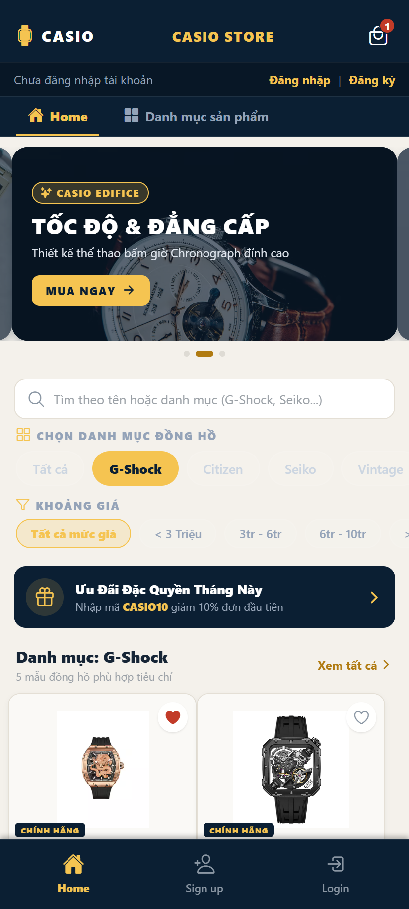

---

### 4. Màn Hình Chi Tiết Sản Phẩm & Thông Số Kỹ Thuật
- **Mã nguồn:** `src/app/product.tsx`
- **Mô tả:** Cung cấp thông tin chi tiết từng mẫu đồng hồ: hình ảnh phóng to độ phân giải cao, khả năng chống nước 20ATM / 200M, chất liệu mặt kính khoáng Mineral / Sapphire, tuổi thọ pin, chính sách bảo hành 5 năm, nút "Thêm vào giỏ" và "MUA NGAY".
- **Minh họa giao diện:**
  
  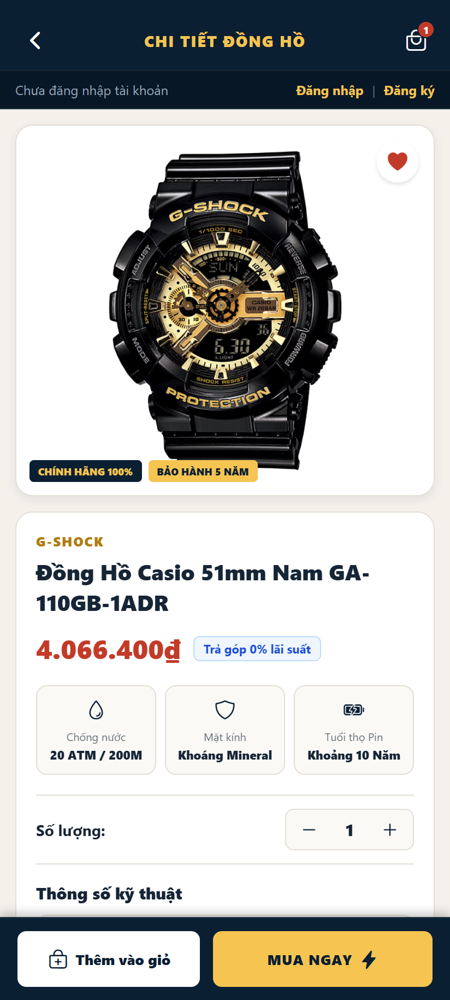

---

### 5. Thanh Điều Hướng Đáy (Bottom Tab) Người Dùng
- **Mã nguồn:** `src/components/bottom-nav.tsx`
- **Mô tả:** Giao diện điều hướng đáy chuẩn cho người dùng thông thường gồm 3 nút chức năng thiết yếu: **Home**, **Sign up**, **Login**.
- **Minh họa giao diện:**
  
  

---

### 6. Quy Trình Đăng Ký Tài Khoản Thành Viên Mới
- **Mã nguồn:** `src/components/auth/RegisterForm.tsx`, `src/hooks/useAuth.ts`
- **Mô tả:** Form đăng ký hoàn chỉnh với cơ chế kiểm tra hợp lệ dữ liệu (Họ tên, SĐT 10 số, định dạng Email, mật khẩu tối thiểu 6 ký tự). Thông tin thành viên mới được lưu trực tiếp vào bảng `users` của SQLite.
- **Minh họa giao diện:**
  
  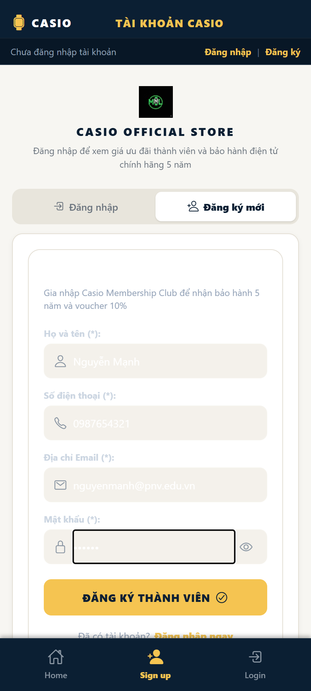

---

### 7. Đăng Nhập Thành Công & Chuyển Hướng Tức Thì
- **Mã nguồn:** `src/components/auth/LoginForm.tsx`
- **Mô tả:** Đăng nhập an toàn với nút hỗ trợ điền nhanh tài khoản mẫu. Khi đăng nhập thành công với tài khoản khách hàng, hệ thống thông báo Toast màu xanh lá và tự động chuyển hướng về trang chủ mua sắm.
- **Minh họa giao diện:**
  
  

---

### 8. Quản Lý Phiên Đăng Nhập & Thông Tin Cá Nhân Tại Header
- **Mã nguồn:** `src/components/Header.tsx`
- **Mô tả:** Thanh Header hiển thị huy hiệu vai trò (MEMBER / VIP GOLD), lời chào cá nhân hóa "Xin chào, Nguyễn Văn Một" và nút "Đăng xuất" kèm Modal hộp thoại xác nhận an toàn.
- **Minh họa giao diện:**
  
  

---

### 9. Công Cụ Tìm Kiếm Thông Minh Theo Tên & Thương Hiệu
- **Mã nguồn:** `src/app/index.tsx`, `src/app/shop.tsx`
- **Mô tả:** Ô tìm kiếm thời gian thực (Real-time Search) cho phép người dùng tra cứu nhanh chóng theo mã sản phẩm hoặc thương hiệu (VD: tìm kiếm "Citizen").
- **Minh họa giao diện:**
  
  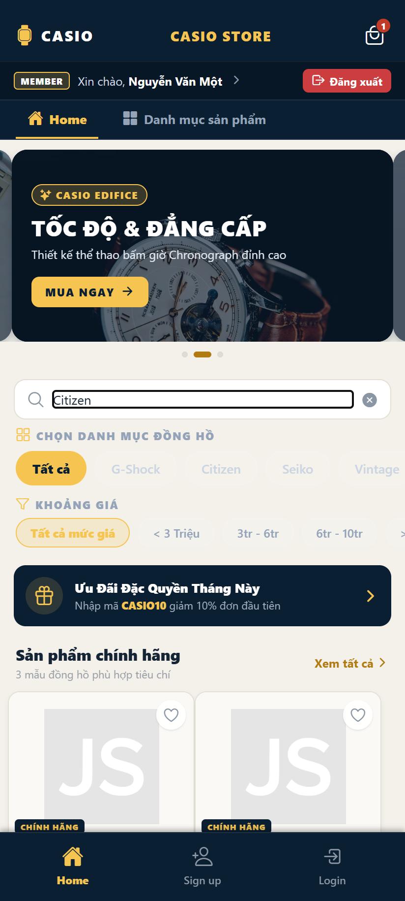

---

### 10. Bộ Lọc Theo Khoảng Giá Đa Dạng
- **Mã nguồn:** `src/app/index.tsx`
- **Mô tả:** Hệ thống lọc phân tầng với 5 mức giá phổ biến: *Tất cả mức giá, < 3 Triệu, 3tr - 6tr, 6tr - 10tr, > 10 Triệu*.
- **Minh họa giao diện:**
  
  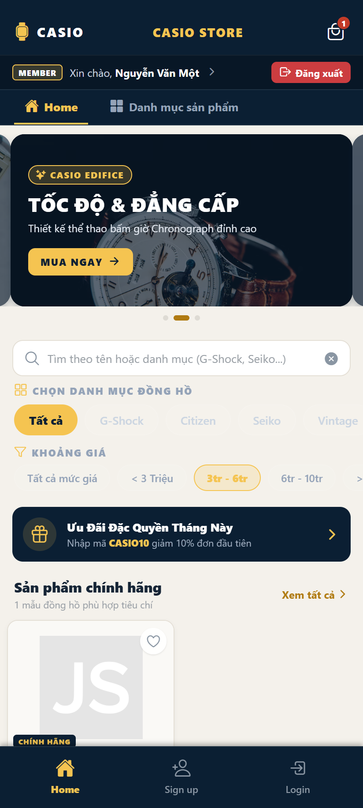

---

### 11. Giỏ Hàng Mua Sắm & Điều Chỉnh Số Lượng
- **Mã nguồn:** `src/app/cart.tsx`
- **Mô tả:** Quản lý sản phẩm đã chọn, điều chỉnh số lượng tăng/giảm `[-] 1 [+]`, xóa sản phẩm, nhập mã giảm giá (`CASIO10`), tính toán tự động phí vận chuyển và tổng tiền đơn hàng.
- **Minh họa giao diện:**
  
  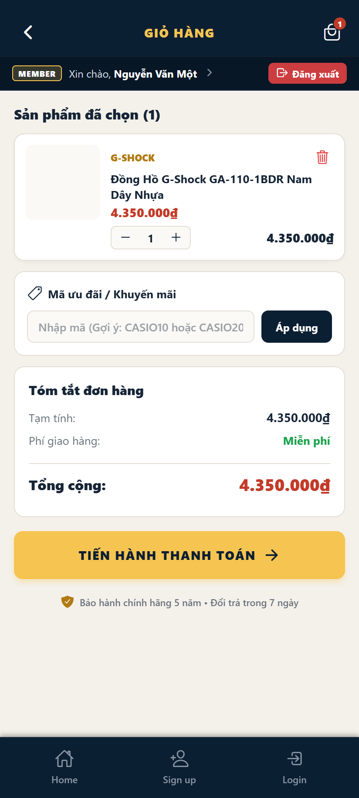

---

### 12. Quy Trình Thanh Toán (Checkout) & Xác Nhận Đặt Hàng
- **Mã nguồn:** `src/app/checkout.tsx`
- **Mô tả:** Biểu mẫu điền địa chỉ giao hàng nhận dạng tự động từ thông tin người dùng, lựa chọn phương thức giao hàng (Tiêu chuẩn / Hỏa tốc 2H), phương thức thanh toán (COD / Chuyển khoản ngân hàng) và nút "XÁC NHẬN ĐẶT HÀNG".
- **Minh họa giao diện:**
  
  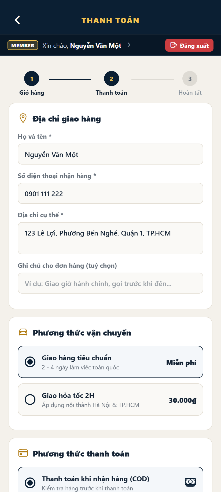

---

### 13. Lịch Sử Mua Hàng & Theo Dõi Tiến Trình Đơn Hàng
- **Mã nguồn:** `src/app/profile.tsx`
- **Mô tả:** Trang hồ sơ khách hàng tích hợp danh sách các đơn hàng đã đặt kèm mã đơn `#CASIO-928145`, thời gian đặt, trạng thái đơn (Đang giao hàng, Đã giao), số lượng sản phẩm và tổng tiền.
- **Minh họa giao diện:**
  
  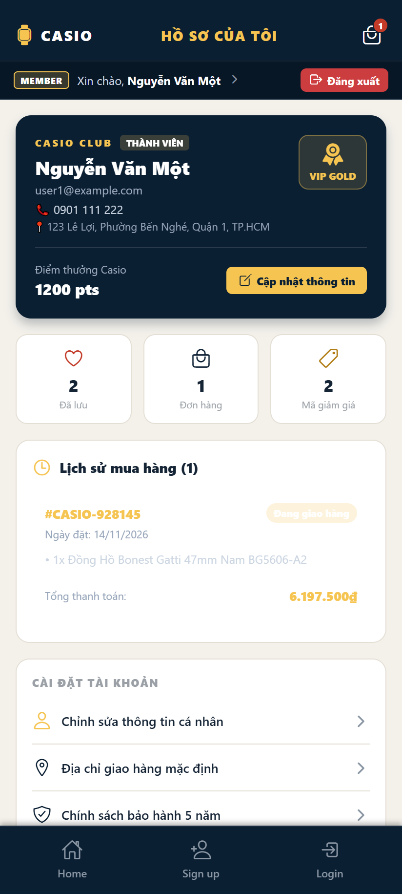

---

### 14. Quản Lý Hồ Sơ & Cập Nhật Thông Tin Cá Nhân
- **Mã nguồn:** `src/app/profile.tsx`
- **Mô tả:** Cho phép thành viên theo dõi điểm tích lũy Casio Points, hạng thẻ VIP GOLD và mở Modal "Cập Nhật Thông Tin" để chỉnh sửa Họ tên, Số điện thoại, Email và Địa chỉ nhận hàng.
- **Minh họa giao diện:**
  
  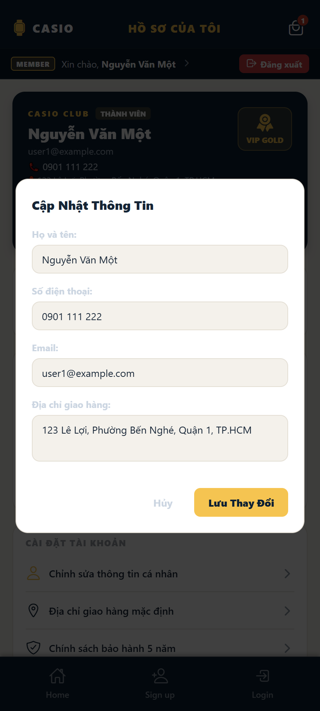

---

## 🛡️ PHẦN 2: HỆ THỐNG QUẢN TRỊ VIÊN (ADMIN MANAGEMENT)

### 15. Khởi Tạo Cơ Sở Dữ Liệu SQLite & Tài Khoản Quản Trị Mặc Định
- **Mã nguồn:** `src/database/sqlite.ts`, `src/app/admin/database.tsx`
- **Mô tả:** Khởi tạo cấu trúc CSDL SQLite gồm 4 bảng (`products`, `categories`, `users`, `orders`). Bảng `users` được nạp sẵn tài khoản Quản trị viên `admin` / `admin123` (Role: `admin`).
- **Minh họa giao diện:**
  
  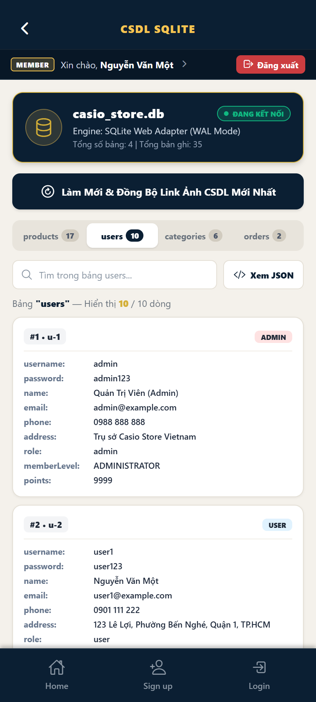

---

### 16. Màn Hình Đăng Nhập Quản Trị Viên Chuyên Biệt
- **Mã nguồn:** `src/components/auth/LoginForm.tsx`
- **Mô tả:** Đăng nhập bằng tài khoản Quản trị viên `admin` / `admin123`.
- **Minh họa giao diện:**
  
  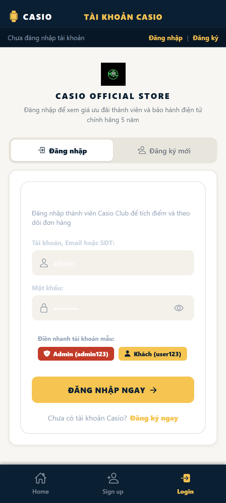

---

### 17. Bảng Điều Khiển Quản Trị Tổng Quan (Admin Dashboard)
- **Mã nguồn:** `src/app/admin/index.tsx`
- **Mô tả:** Trung tâm điều hành dành cho quản trị viên, hiển thị số liệu thống kê thời gian thực: Tổng người dùng (10), Loại sản phẩm (6), Sản phẩm trong kho (17), Đơn hàng (2) cùng các menu điều hướng nhanh.
- **Minh họa giao diện:**
  
  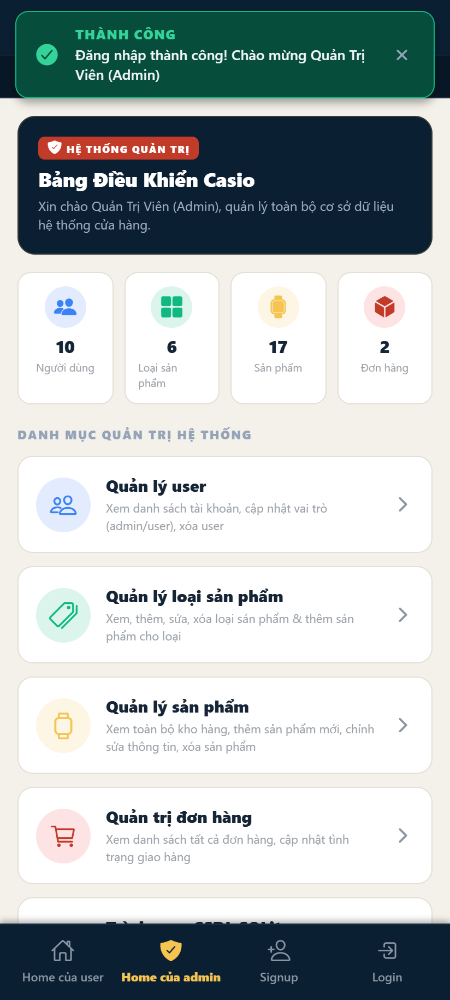

---

### 18. Thanh Bottom Tab Chuyên Biệt 4 Nút Dành Cho Admin
- **Mã nguồn:** `src/components/bottom-nav.tsx`
- **Mô tả:** Khi tài khoản có vai trò `admin` đăng nhập, thanh điều hướng đáy tự động cấu hình thành 4 nút: **Home của user**, **Home của admin**, **Signup**, **Login** giúp chuyển đổi linh hoạt giữa giao diện khách hàng và quản trị.
- **Minh họa giao diện:**
  
  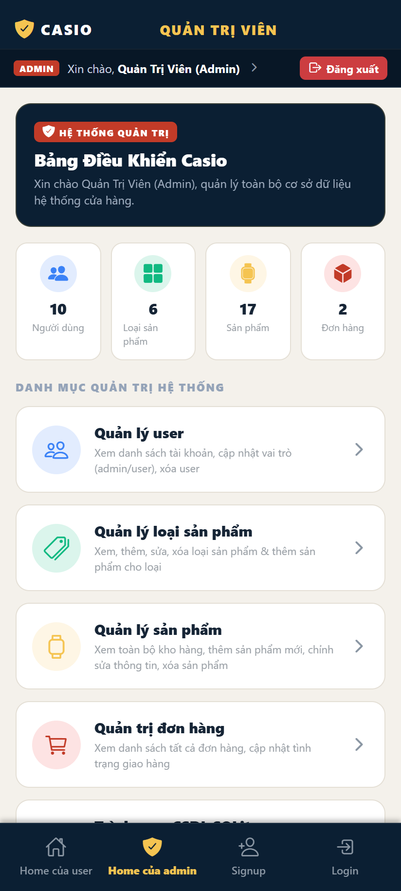

---

### 19. Phân Hệ Quản Trị Người Dùng (User Management)
- **Mã nguồn:** `src/app/admin/users.tsx`
- **Mô tả:** Xem danh mục toàn bộ tài khoản trong hệ thống SQLite, thanh tìm kiếm người dùng, chức năng cập nhật vai trò (chuyển đổi qua lại giữa `admin` <-> `user`) và nút "Xóa User" an toàn.
- **Minh họa giao diện:**
  
  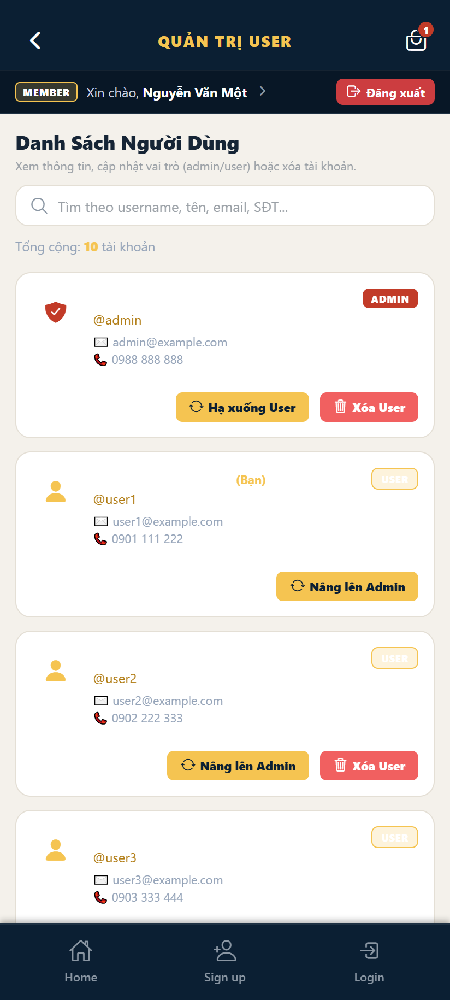

---

### 20. Phân Hệ Quản Trị Loại Sản Phẩm (Category Management)
- **Mã nguồn:** `src/app/admin/categories.tsx`
- **Mô tả:** Danh sách các dòng đồng hồ, hỗ trợ các thao tác CRUD: thêm loại mới, đổi tên loại, xóa loại (có cơ chế kiểm tra ràng buộc số lượng sản phẩm) và nút chức năng đặc biệt "+ Thêm sản phẩm cho loại tương ứng".
- **Minh họa giao diện:**
  
  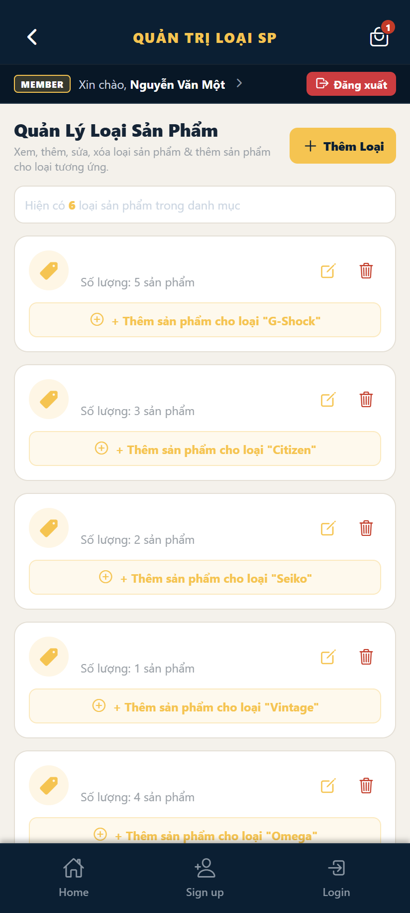

---

### 21. Phân Hệ Quản Lý Toàn Diện Kho Sản Phẩm (Product Catalog CRUD)
- **Mã nguồn:** `src/app/admin/products.tsx`
- **Mô tả:** Giám sát toàn bộ kho hàng, thanh lọc danh mục, nút "+ Thêm SP mới", chỉnh sửa thông số/giá bán và xóa sản phẩm khỏi cơ sở dữ liệu.
- **Minh họa giao diện:**
  
  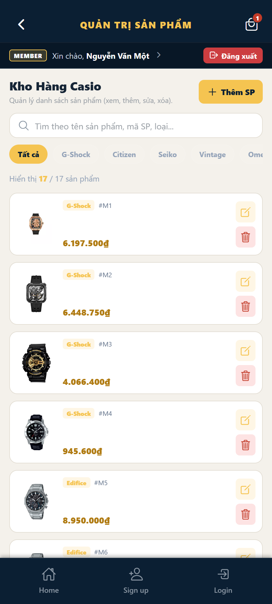

---

### 22. Phân Hệ Quản Lý & Điều Phối Đơn Hàng (Order Management)
- **Mã nguồn:** `src/app/admin/orders.tsx`
- **Mô tả:** Theo dõi danh sách đơn đặt hàng từ khách hàng, lọc theo trạng thái (Chờ xác nhận, Đang xử lý, Đang giao hàng, Đã giao) và nút "Đổi trạng thái" để cập nhật quy trình vận đơn.
- **Minh họa giao diện:**
  
  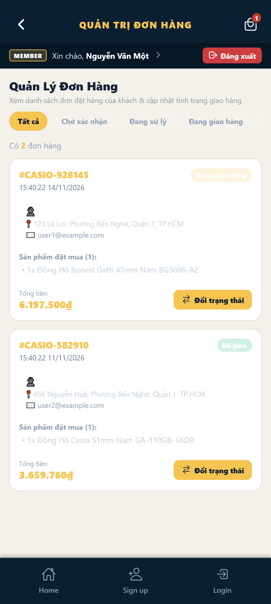

---

## 🛠️ Kiến Trúc Công Nghệ

- **Framework:** React Native `0.88.1` / React `19.3.0`
- **CLI & Platform:** Expo SDK `~58.0.23`
- **Routing:** Expo Router `~58.0.30` (File-based navigation)
- **Database:** SQLite (`expo-sqlite ~58.0.15`)
- **Icons & Styling:** `@expo/vector-icons` (Ionicons), StyleSheet API với Design System đồng bộ
- **Quản lý State:** React Context API (`StoreContext`) kết hợp SQLite Web/Native Adapter
