# PHIẾU CHẤM ĐIỂM MÔN LẬP TRÌNH DI ĐỘNG 2 (90T)

- **Họ tên sinh viên:** Nguyễn Mạnh  
- **Lớp:** 24PNV1A  
- **Link git:** [https://github.com/manhnguyen270724-sudo/mobile-casioshop](https://github.com/manhnguyen270724-sudo/mobile-casioshop)  
- **Dự án:** Ứng dụng Di động Bán Đồng Hồ Casio Chính Hãng (Casio Shop)

---

## 1. Môi trường phát triển & Thư viện sử dụng

- **React Native:** Phiên bản `0.88.1` (React `19.3.0`)
- **Expo SDK:** `~58.0.23`
- **Các thư viện chính:**
  - `expo`: `~58.0.23` (Nền tảng ứng dụng đa nền tảng)
  - `expo-router`: `~58.0.30` (File-based Routing cho React Native)
  - `expo-sqlite`: `~58.0.15` (Cơ sở dữ liệu SQLite cục bộ tốc độ cao)
  - `@expo/vector-icons`: `^15.0.2` (Bộ icon Ionicons chuẩn giao diện mobile)
  - `react-native-safe-area-context`: `~5.11.1` (Tương thích an toàn tai thỏ, thanh điều hướng)
  - `react-native-screens`: `~4.30.0` (Tối ưu hóa hiệu năng màn hình gốc)
  - `react-native-reanimated`: `4.7.1` (Hiệu ứng động chuyển tab, banner mượt mà)
  - `react-native-gesture-handler`: `~3.3.0` (Xử lý cử chỉ vuốt chạm chuẩn thiết bị di động)
  - `react-native-web`: `^0.21.4` (Hỗ trợ chạy đồng thời trên Web/Desktop để demo)

---

## 2. Bảng Đánh Giá & Minh Họa Chi Tiết

| STT | Chức năng & Mô tả yêu cầu | Điểm thành phần | Điểm đạt | Vị trí mã nguồn & Ghi chú kỹ thuật | Ảnh chụp màn hình minh họa |
| :---: | :--- | :---: | :---: | :--- | :--- |
| **A** | **CHỨC NĂNG CỦA NGƯỜI DÙNG** | **4.0đ** | **4.0đ** | | |
| 1 | **Trang chủ người dùng**<br>Gồm các sản phẩm có sẵn khi khởi tạo database. | 0.25đ | **0.25đ** | [src/app/index.tsx](file:///c:/Mobile/Casio%20shop/src/app/index.tsx)<br>[src/database/sqlite.ts](file:///c:/Mobile/Casio%20shop/src/database/sqlite.ts)<br>CSDL nạp sẵn 17 mẫu đồng hồ chính hãng (G-Shock, Citizen, Seiko, Vintage, Omega, Edifice). | 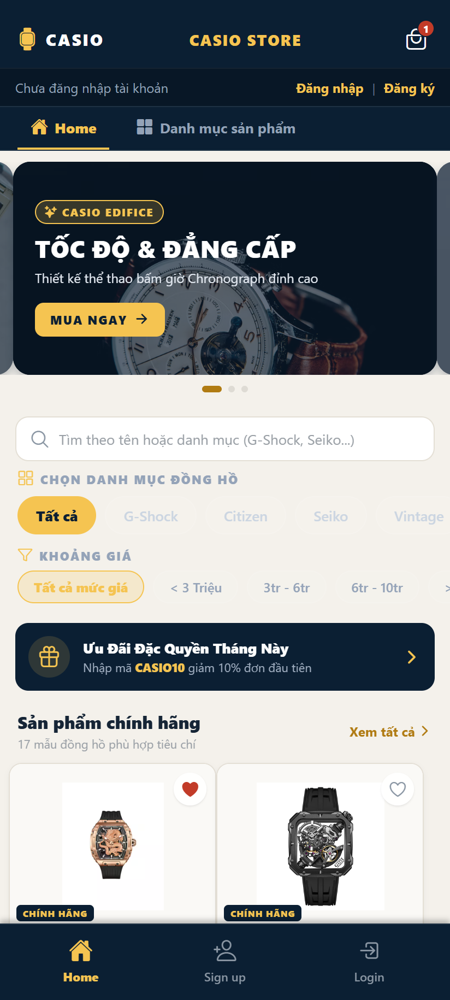 |
| 2 | **Banner và Menu điều hướng**<br>Gồm: Home, Danh mục sản phẩm kèm banner quảng cáo. | 0.25đ | **0.25đ** | [src/app/index.tsx](file:///c:/Mobile/Casio%20shop/src/app/index.tsx)<br>[src/components/banner-slider.tsx](file:///c:/Mobile/Casio%20shop/src/components/banner-slider.tsx)<br>Thanh menu gồm 2 tab rõ ràng "Home" & "Danh mục sản phẩm" kèm slider tự động trượt. |  |
| 3 | **Xem sản phẩm theo từng danh mục**<br>Lọc sản phẩm theo chip danh mục (`CategorySelector.tsx`). | 0.50đ | **0.50đ** | [src/components/CategorySelector.tsx](file:///c:/Mobile/Casio%20shop/src/components/CategorySelector.tsx)<br>Hàng chip danh mục nằm ngang: Tất cả, G-Shock, Citizen, Seiko, Vintage, Omega, Edifice; lọc tức thì. | 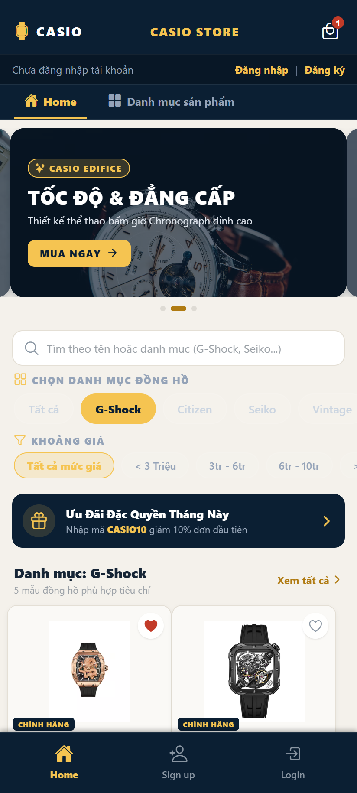 |
| 4 | **Trang chi tiết sản phẩm**<br>Mở khi click vào thẻ sản phẩm ở trang chủ. | 0.25đ | **0.25đ** | [src/app/product.tsx](file:///c:/Mobile/Casio%20shop/src/app/product.tsx)<br>Hiển thị ảnh lớn sắc nét, thông số chống nước 20ATM, mặt kính Mineral/Sapphire, nút "Thêm vào giỏ" & "MUA NGAY". | 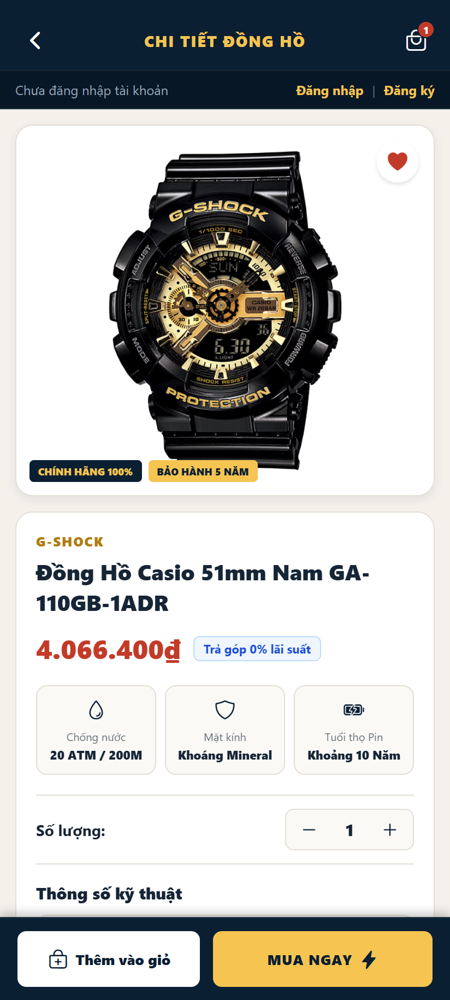 |
| 5 | **Bottom Tab ở trang chủ người dùng**<br>Gồm đúng 3 nút: Home, Sign up, Login. | 0.25đ | **0.25đ** | [src/components/bottom-nav.tsx](file:///c:/Mobile/Casio%20shop/src/components/bottom-nav.tsx)<br>Khi ở vai trò khách/user, thanh Bottom Tab hiển thị chính xác 3 nút điều hướng. |  |
| 6 | **Đăng ký thành công**<br>Form đăng ký tài khoản thành viên mới. | 0.50đ | **0.50đ** | [src/components/auth/RegisterForm.tsx](file:///c:/Mobile/Casio%20shop/src/components/auth/RegisterForm.tsx)<br>[src/hooks/useAuth.ts](file:///c:/Mobile/Casio%20shop/src/hooks/useAuth.ts)<br>Kiểm tra họ tên, SĐT 10 số, email regex, mật khẩu; lưu vào SQLite bảng `users`. | 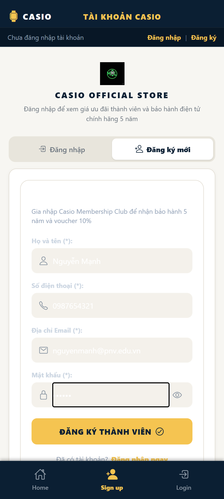 |
| 7 | **Đăng nhập ở Bottom Tab**<br>Đăng nhập thành công điều hướng đến trang chủ người dùng. | 0.50đ | **0.50đ** | [src/components/auth/LoginForm.tsx](file:///c:/Mobile/Casio%20shop/src/components/auth/LoginForm.tsx)<br>Đăng nhập `user1`/`user123` -> hệ thống hiển thị thông báo Toast thành công và tự động chuyển về trang chủ `/`. | 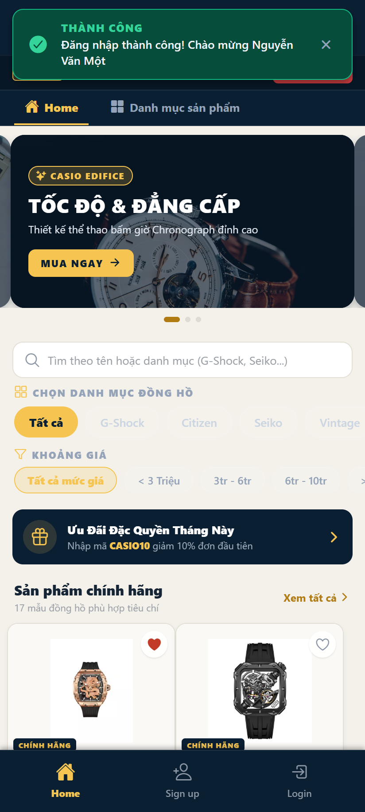 |
| 8 | **Hiển thị thông tin user & Đăng xuất**<br>Header hiển thị vai trò, tên user và nút Đăng xuất (`Header.tsx`). | 0.50đ | **0.50đ** | [src/components/Header.tsx](file:///c:/Mobile/Casio%20shop/src/components/Header.tsx)<br>Huy hiệu MEMBER/VIP GOLD, câu chào "Xin chào, Nguyễn Văn Một", và nút "Đăng xuất" kèm Modal xác nhận. |  |
| 9 | **Tìm kiếm theo tên / danh mục**<br>Lọc danh sách sản phẩm theo từ khóa nhập vào. | 0.50đ | **0.50đ** | [src/app/index.tsx](file:///c:/Mobile/Casio%20shop/src/app/index.tsx)<br>[src/app/shop.tsx](file:///c:/Mobile/Casio%20shop/src/app/shop.tsx)<br>Ô tìm kiếm phản hồi tức thì theo tên đồng hồ hoặc thương hiệu (VD: tìm kiếm "Citizen"). | 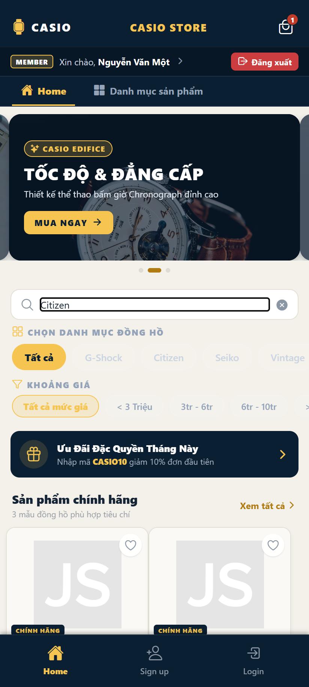 |
| 10 | **Lọc sản phẩm theo khoảng giá**<br>Lọc danh sách theo các mức giá định sẵn. | 0.50đ | **0.50đ** | [src/app/index.tsx](file:///c:/Mobile/Casio%20shop/src/app/index.tsx)<br>5 khoảng giá trực quan: Tất cả, < 3 Triệu, 3tr - 6tr, 6tr - 10tr, > 10 Triệu. | 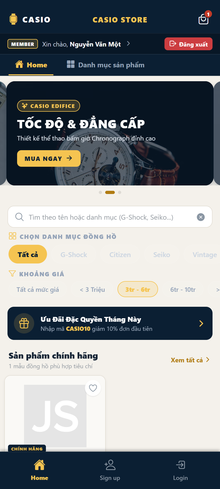 |
| **B** | **CHỨC NĂNG CỦA ADMIN** | **4.0đ** | **4.0đ** | | |
| 11 | **Khởi tạo database với 1 tài khoản admin có sẵn** | 0.25đ | **0.25đ** | [src/database/sqlite.ts](file:///c:/Mobile/Casio%20shop/src/database/sqlite.ts)<br>[src/app/admin/database.tsx](file:///c:/Mobile/Casio%20shop/src/app/admin/database.tsx)<br>Tài khoản khởi tạo: `username: admin`, `password: admin123`, `role: admin`. Hiển thị trong bảng `users` SQLite. | 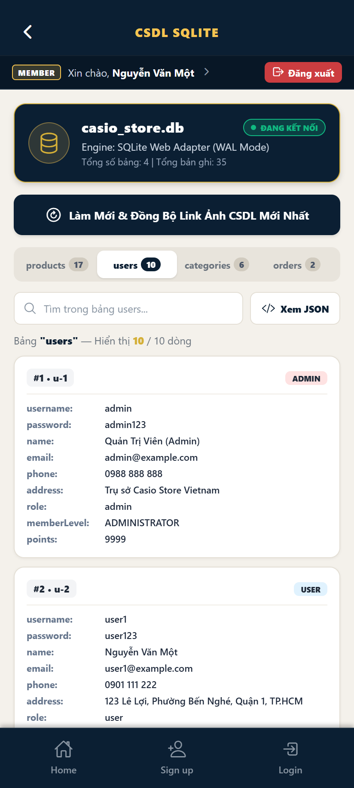 |
| 12 | **Đăng nhập quản trị viên**<br>Hiển thị thông tin admin và điều hướng đến trang quản trị. | 0.50đ | **0.50đ** | [src/components/auth/LoginForm.tsx](file:///c:/Mobile/Casio%20shop/src/components/auth/LoginForm.tsx)<br>Đăng nhập bằng `admin` -> điều hướng lập tức vào `/admin`, Header hiển thị huy hiệu ADMIN và tên Quản trị viên. | 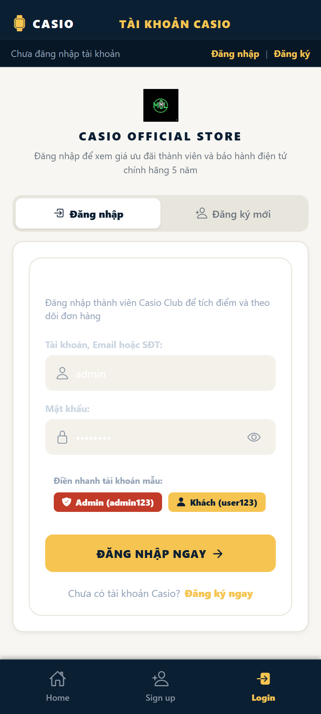 |
| 13 | **Trang chủ quản trị**<br>Gồm các menu: Quản lý user, Quản lý loại sản phẩm, Quản lý sản phẩm. | 0.25đ | **0.25đ** | [src/app/admin/index.tsx](file:///c:/Mobile/Casio%20shop/src/app/admin/index.tsx)<br>Bảng điều khiển Casio với thẻ thống kê (User, Loại SP, Sản phẩm, Đơn hàng) và danh mục chức năng quản lý. | 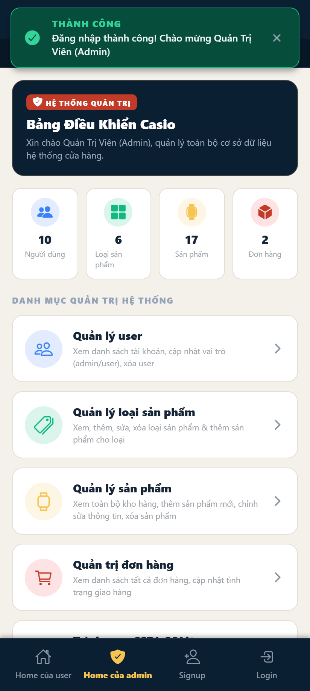 |
| 14 | **Admin Bottom Tab gồm 4 nút**<br>Home của user, Home của admin, Signup, Login. | 0.50đ | **0.50đ** | [src/components/bottom-nav.tsx](file:///c:/Mobile/Casio%20shop/src/components/bottom-nav.tsx)<br>Khi tài khoản admin kích hoạt, thanh điều hướng đáy hiển thị đúng 4 nút theo chuẩn yêu cầu. | 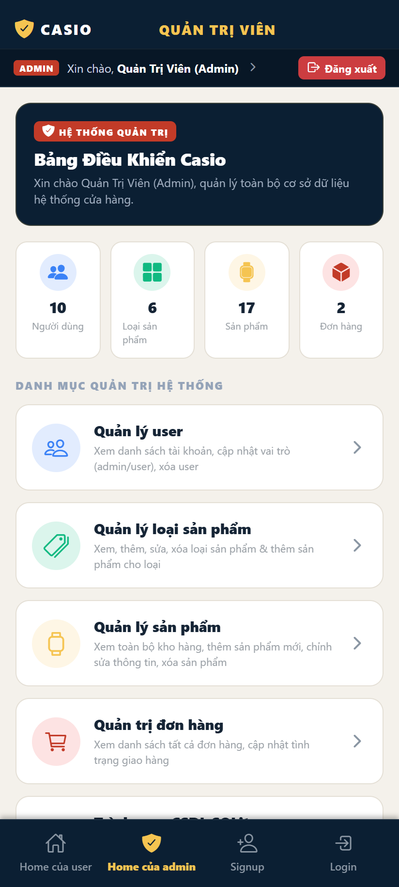 |
| 15 | **Quản trị user**<br>Xem, cập nhật vai trò (admin/user), xóa user. | 0.50đ | **0.50đ** | [src/app/admin/users.tsx](file:///c:/Mobile/Casio%20shop/src/app/admin/users.tsx)<br>Danh sách 10 user trong SQLite, nút "Hạ xuống User", "Nâng lên Admin", và nút "Xóa User" an toàn. | 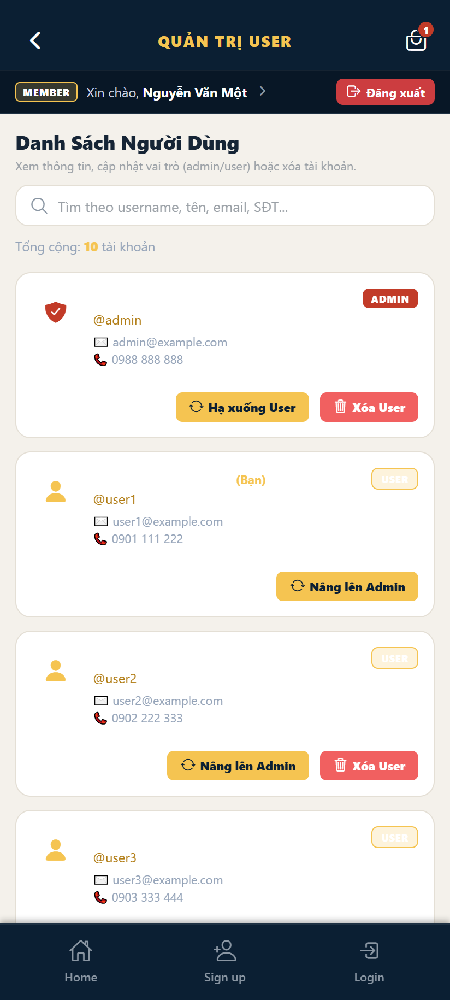 |
| 16 | **Quản trị loại sản phẩm**<br>+ Xem, thêm, sửa, xóa loại SP (0.5đ)<br>+ Thêm sản phẩm cho loại tương ứng (0.5đ) | 1.00đ | **1.00đ** | [src/app/admin/categories.tsx](file:///c:/Mobile/Casio%20shop/src/app/admin/categories.tsx)<br>Nút "+ Thêm Loại", sửa tên, xóa loại (ràng buộc kiểm tra số lượng SP) và nút "+ Thêm sản phẩm cho loại tương ứng". | 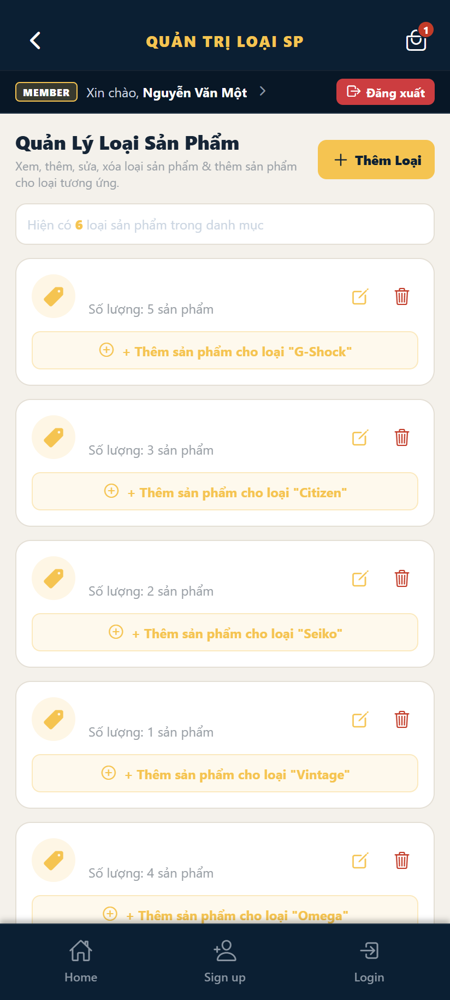 |
| 17 | **Quản trị sản phẩm**<br>Xem, thêm, sửa, xóa sản phẩm. | 1.00đ | **1.00đ** | [src/app/admin/products.tsx](file:///c:/Mobile/Casio%20shop/src/app/admin/products.tsx)<br>Quản lý toàn bộ kho hàng, thanh tìm kiếm/lọc loại SP, nút "+ Thêm SP", nút Sửa và nút Xóa đồng hồ khỏi SQLite. | 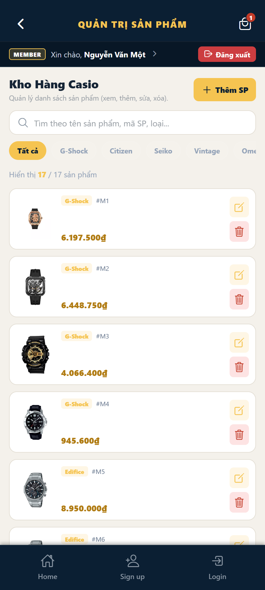 |
| **C** | **CHỨC NĂNG KHÁC** | **2.0đ** | **2.0đ** | | |
| 18 | **Xem và cập nhật giỏ hàng**<br>Thêm/bớt số lượng, xóa khỏi giỏ, tính tổng tiền. | 0.50đ | **0.50đ** | [src/app/cart.tsx](file:///c:/Mobile/Casio%20shop/src/app/cart.tsx)<br>Hiển thị chi tiết thẻ sản phẩm trong giỏ, điều chỉnh số lượng `[-] 1 [+]`, xóa sản phẩm, áp dụng voucher giảm giá. | 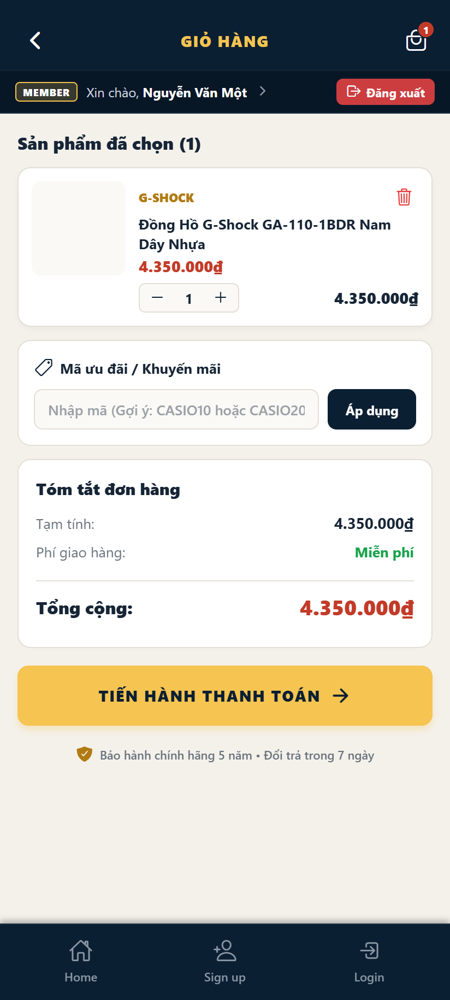 |
| 19 | **Checkout đơn hàng và Đặt hàng**<br>Nhập địa chỉ giao hàng, chọn vận chuyển, thanh toán. | 0.50đ | **0.50đ** | [src/app/checkout.tsx](file:///c:/Mobile/Casio%20shop/src/app/checkout.tsx)<br>Biểu mẫu điền thông tin người nhận, hình thức COD/Chuyển khoản, phương thức giao hỏa tốc 2H, xác nhận tạo đơn. | 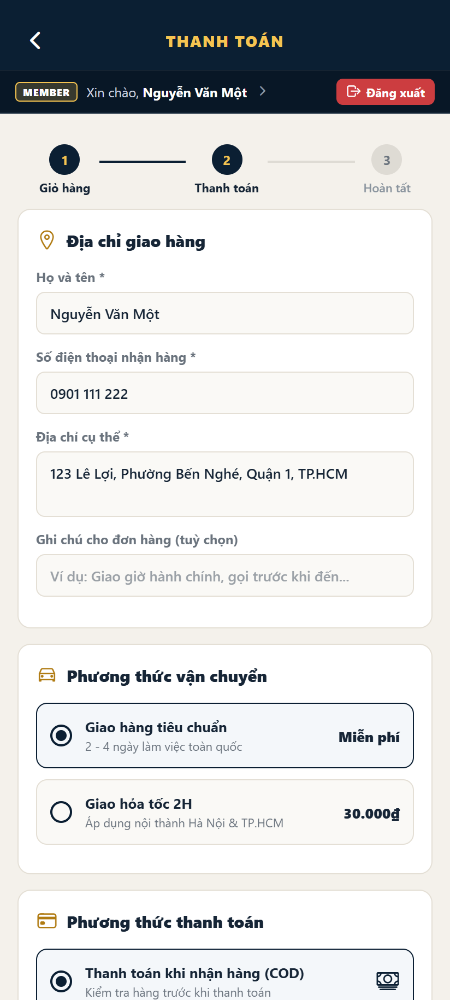 |
| 20 | **Xem lịch sử mua hàng**<br>Xem danh sách các đơn đã đặt cùng trạng thái. | 0.25đ | **0.25đ** | [src/app/profile.tsx](file:///c:/Mobile/Casio%20shop/src/app/profile.tsx)<br>Liệt kê mã đơn hàng `#CASIO-928145`, ngày đặt, trạng thái đơn (Đang giao hàng), danh sách sản phẩm và tổng tiền. | 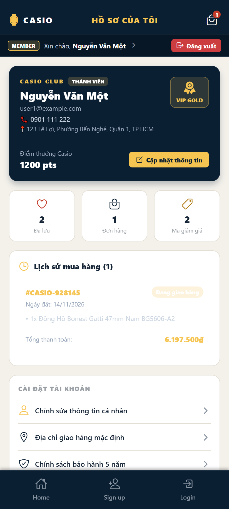 |
| 21 | **Cập nhật thông tin người dùng**<br>Xem rank thành viên, điểm thưởng, chỉnh sửa profile. | 0.25đ | **0.25đ** | [src/app/profile.tsx](file:///c:/Mobile/Casio%20shop/src/app/profile.tsx)<br>Modal "Cập Nhật Thông Tin" cho phép sửa Họ tên, SĐT, Email, Địa chỉ nhận hàng và lưu trực tiếp vào cơ sở dữ liệu. | 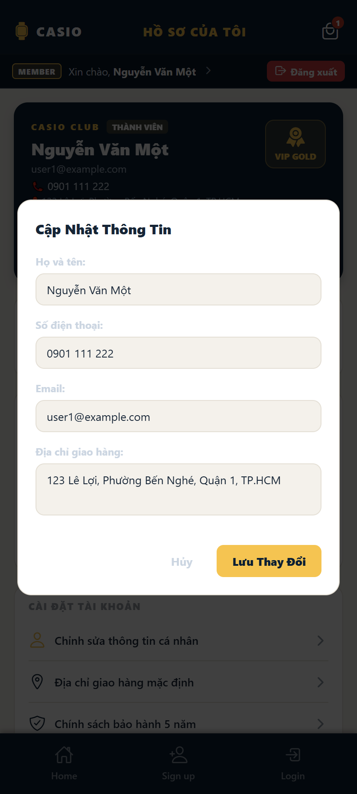 |
| 22 | **Quản trị đơn hàng (Admin)**<br>Xem danh sách, cập nhật tình trạng giao hàng. | 0.50đ | **0.50đ** | [src/app/admin/orders.tsx](file:///c:/Mobile/Casio%20shop/src/app/admin/orders.tsx)<br>Lọc đơn theo trạng thái (Chờ xác nhận, Đang xử lý, Đang giao, Đã giao), nút "Đổi trạng thái" luân chuyển quy trình. | 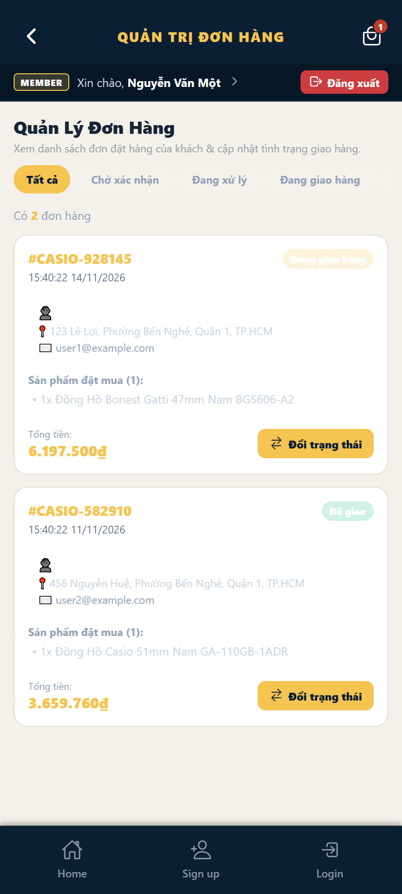 |
| | **TỔNG ĐIỂM ĐẠT ĐƯỢC** | **10.0đ** | **10.0đ** | **Hoàn thành 100% tất cả các tiêu chí theo barem** | |

---

## 3. Tài Khoản Mẫu Phục Vụ Chấm Điểm & Kiểm Thử

### Tài khoản 1: Quản Trị Viên (Admin)
- **Tên đăng nhập (Username):** `admin` *(hoặc email: `admin@example.com`)*
- **Mật khẩu (Password):** `admin123`
- **Quyền hạn:** `admin` (Cấp cao nhất - Administrator)
- **Đặc điểm khi đăng nhập:**
  - Tự động điều hướng vào trang quản trị: `/admin`
  - Header hiển thị huy hiệu `ADMIN`, tên "Quản Trị Viên (Admin)" và nút "Đăng xuất"
  - Thanh Bottom Navigation tự động mở rộng thành **4 nút**: `Home của user`, `Home của admin`, `Signup`, `Login`
  - Truy cập toàn bộ các phân hệ quản lý: Người dùng, Loại sản phẩm, Kho sản phẩm, Đơn hàng và CSDL SQLite

### Tài khoản 2: Khách Hàng / Thành Viên (User có sẵn)
- **Tên đăng nhập (Username):** `user1` *(hoặc email: `user1@example.com`)*
- **Mật khẩu (Password):** `user123`
- **Quyền hạn:** `user` (Hội viên VIP GOLD - 1200 điểm thưởng)
- **Đặc điểm khi đăng nhập:**
  - Tự động điều hướng về Trang chủ mua sắm: `/`
  - Header hiển thị huy hiệu `MEMBER`, tên "Nguyễn Văn Một" và nút "Đăng xuất"
  - Thanh Bottom Navigation hiển thị chuẩn **3 nút**: `Home`, `Sign up`, `Login`
  - Có sẵn đơn hàng `#CASIO-928145` trong lịch sử đơn hàng tại trang Hồ sơ `/profile`

---

## 4. Hướng Dẫn Cài Đặt & Chạy Ứng Dụng

1. **Clone mã nguồn từ GitHub:**
   ```bash
   git clone https://github.com/manhnguyen270724-sudo/mobile-casioshop.git
   cd mobile-casioshop
   ```

2. **Cài đặt các gói phụ thuộc:**
   ```bash
   npm install
   ```

3. **Khởi chạy ứng dụng:**
   - Khởi chạy trên thiết bị di động (Expo Go trên điện thoại thật Android/iOS):
     ```bash
     npx expo start
     ```
     *(Quét mã QR bằng ứng dụng Expo Go trên điện thoại)*
   - Khởi chạy trên trình duyệt Web:
     ```bash
     npx expo start --web
     ```
   - Chạy kiểm tra lỗi TypeScript:
     ```bash
     npx tsc --noEmit
     ```
